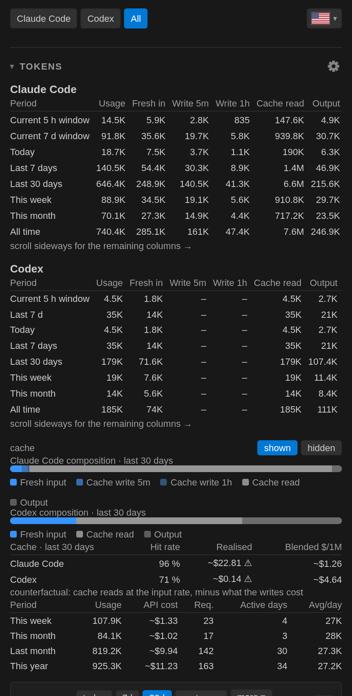

# Token Pace — Claude Code & Codex

Quota, tokens and API cost for **Claude Code** and **Codex**, permanently in the VS Code
status bar, with a detailed tooltip, a dashboard in the secondary sidebar, and text-only
views for the places a webview cannot go.

The bars are coloured by **pace**, not by level: green while consumption stays at or below
the share of the window that has already elapsed, yellow once it runs ahead of pace,
red when the window is spent. A 60 % bar is reassuring an hour before the reset and alarming
five minutes in — a fixed threshold cannot tell those apart.

```
CC 5h ██┃▁▁▁▁▁ 25% · resets 2h14m      CC 7d █████┃▁▁ 69% ▲ · resets 4d 6h
CDX 5h ███┃▁▁▁▁ 33% · resets 1h05m     CC Fable 7d █┃▁▁▁▁▁▁ 12% · resets 4d 6h
Σ 4.6M · today                         ~$1.23 · today
```


![The Token Pace dashboard in the secondary sidebar: the provider switch Claude Code · Codex · All and the flag of the language picker at the top; quota cards with pace verdict, forecast, the subagents' share of each Claude window and a seven-day sparkline coloured by pace; the Agents section with the agents running now over the tree of the active session, its workflow run and agents — each row with its state, usage, duration and tally, the names in the colour of their state, guide lines from every child to its parent — and the closed row of earlier sessions; the Tokens section folded, the filter block and the summary](media/screenshot-dashboard.png)




The pictures are rendered from **preview data** (*Token Pace: Preview Status Bar States*
and a synthetic snapshot), not from anybody's real usage.

**Requires VS Code 1.106 or newer.** The dashboard lives in the secondary sidebar, and
`contributes.viewsContainers.secondarySidebar` only became a stable contribution point in
1.106 (in 1.104 it was behind the `contribSecondarySideBar` proposed API). Editors built on an
older VS Code base — Cursor and Windsurf currently are — cannot install it until they rebase;
VSCodium tracks the VS Code releases and gets it from Open VSX.

Not affiliated with, endorsed by, or sponsored by Anthropic or OpenAI. “Claude” and “Codex” are the
trademarks of their respective owners and are used here only to name the tools whose output is read.

## What you see

* **A status bar entry per quota window**, model-scoped ones included: a pace-coloured bar with the
  elapsed marker, the percentage and the countdown to the reset. `windowSelect` decides how many
  appear, `statusBar.show` which kinds exist and in which order, `density` how much text each one
  gets. → [Status bar](docs/status-bar.md), [every state it can show](docs/status-bar-states.md)
* **A tooltip with the whole picture**: the window table with used, elapsed, pace and reset,
  a forecast line per window, the token tables for today / 7 days / 30 days, the freshness
  line and a provenance line that names what was measured and what was estimated. When a fetch of
  Token Pace's own fails — a `429` and its backoff — the old figure stays and says so: *Last attempt
  at 14:20 failed: HTTP 429 … · next attempt in 1h12m* in the tooltip and on the card, and
  `· $(clock) retry 1h12m` after the age of a stale entry. → [Quota sources](docs/quota-sources.md)
* **A dashboard in the secondary sidebar**, a provider switch at the very top — `Claude Code ·
  Codex · All` — that shows the whole page for one provider or for both: quota cards that explain
  their own colour, a seven-day sparkline, the key figures, the daily chart by model with the cost
  line, and the fixed-period token totals. → [Dashboard](docs/dashboard.md)
* **A prompt cache that says when it cools.** Five minutes before a Claude Code session's one-hour
  cache expires, the Claude card says so — `prompt cache cools in 4 m 10 s (1 h TTL)` — and what a
  cold start would re-write instead of reading it from the cache, measured by the status line or
  estimated from the transcript and marked `~`. `cache` in `statusBar.show` adds `$(watch) cache 4m`;
  the Codex card says `~until 14:52, perhaps longer`. → [Prompt cache](docs/prompt-cache.md)
* **Keep-warm, opt-in and off by default.** With three minutes or less left of a measured cache and
  every check holding, a one-minute countdown you can cancel, then one fixed line typed into the
  session's terminal. A draft left in Claude Code's input line is sent along, the Claude Code
  extension's panel is out of reach, each line is a real request, and Anthropic's terms do not
  explicitly permit it. → [Keep-warm in a terminal](docs/prompt-cache.md#keep-warm-in-a-terminal-opt-in)
* **Your Claude Code agents as a tree**: the agents running now listed on top, then the active
  sessions with their workflow runs and agents, and every other session of the last seven days in
  one closed row, `Earlier sessions (12)` — closed until you open them, fifty children at a time —
  each with its state, usage, duration and a tally of what the agents below came to (`427 started ·
  390 ✓ · 15 ✕ · 10 ↻ · ~11 ● · ~1 ?`), live while it runs. A name says its state in colour as well
  — green done, yellow unknown, red failed, blue running —, never as the only sign, and guide lines
  connect every child to its parent. Failed, stopped, retried and replaced agents are told apart, a
  run's own recorded end and a rejected request are named, and a click opens the details under the
  row — effort, token mix, tool errors, cache misses, compactions, Claude Code's own run record. A
  state that is only inferred says so, and nothing of a prompt or a result is read. The tree is a
  tree to the keyboard and a screen reader too. → [Agents](docs/agents.md)
* **Where the agent tokens went**: a 7-day block by agent type and model with the five largest
  agents, and under each Claude window's bar the subagents' share of what was counted over it —
  a share of tokens, never of the quota. The chart can split every day by main session and
  subagent. → [Dashboard](docs/dashboard.md)
* **Running agents in the status bar, opt-in**: `agents` in `statusBar.show` shows `~3 running`
  while any runs, with no colour and no alarm. And, opt-in as well, an **agent hook** you install
  into Claude Code yourself marks an agent that waits for your approval.
  → [Status bar](docs/status-bar.md), [the agent hook](docs/agents.md#the-agent-hook)
* **The same figures without a webview**: a markdown report, a searchable Quick Pick, a CSV
  and a JSON export — the agents included in all of them — and a diagnostics report that is safe
  to paste into an issue. → [Export and diagnostics](docs/export.md)
* **Quota without the network.** Percentages come from the provider and cover every client;
  out of the box they are read from local sources somebody else wrote. Fetching them
  ourselves is a separate decision, asked once; on Windows its user agent names the Claude Code
  version this machine runs, without starting the npm `.cmd` shim.
  → [Quota sources](docs/quota-sources.md), [Windows](docs/windows-wsl-remote.md)
* **Nothing invented.** A missing figure is `–`, never `0 %`; a window without a stated length
  gets no pace rather than an invented denominator; estimates carry `~` and lower bounds `⚠`.
  → [Numbers, words and pace](docs/numbers.md)
* **Fourteen languages.** A flag at the top of the dashboard switches the status bar, the dashboard,
  the Quick Pick, the report and every dialog at once — to English, Deutsch, Français, Español,
  Português (Brasil), Italiano, 日本語, 한국어, 简体中文, 繁體中文, Русский, Türkçe, Polski or Čeština, or to
  VS Code's display language. The twelve beyond English and German were translated by AI agents and checked by tests, not by native speakers. → [Languages](docs/languages.md)

## Install

* **Visual Studio Marketplace** — search for *Token Pace* in the Extensions view, or
  `code --install-extension frederik.token-pace`
  ([store page](https://marketplace.visualstudio.com/items?itemName=frederik.token-pace)).
* **Open VSX** — the same extension for VSCodium and everything else that uses that registry:
  `codium --install-extension frederik.token-pace`
  ([store page](https://open-vsx.org/extension/frederik/token-pace)).
* **`.vsix`** — download it from the
  [GitHub releases](https://github.com/mfvdp/VS-Code_Token-Usage/releases) and install with
  `code --install-extension token-pace-<version>.vsix`, or *Extensions → … → Install from
  VSIX…*. The package is platform-independent; there is no native code.

Nothing has to be configured. If Claude Code or Codex runs on the other side of a remote —
WSL, SSH, a container — see [Windows, WSL and remote development](docs/windows-wsl-remote.md).

## Privacy

Out of the box this extension makes **no network access at all**: token counts are read from
local transcript files, and quota percentages from local sources somebody else wrote — a cache
file, Claude Code's own status line, `~/.claude.json`, the Codex transcripts.

Fetching quota ourselves is a separate decision, asked for once, in a dialog that states
exactly what is sent where; the access token is read only then, only from
`~/.claude/.credentials.json`, and only ever sent to `https://api.anthropic.com/api/oauth/usage`.
By default the request names the Claude Code version this machine runs — from `claude --version`,
on Windows only from a `claude.exe` on the `PATH`, never through the `.cmd` shim or a shell, else the
version the newest Claude Code session wrote into its transcript —, and the extension's own
`quota.json` keeps the last failed attempt: its time, its kind and the fetch's own words, never a
token, a header or an exception's text.

`~/.claude/ide/*.lock`, `~/.claude/sessions/*.key` and the `oauthAccount` block of
`~/.claude.json` are **never** touched, and symlinks are not followed while scanning.

Transcript contents — prompts, responses, tool arguments and tool results — are never stored,
logged, exported or displayed. Nothing is written outside the extension's own storage except the
shared quota cache file and the status-line bridge — which keeps only the fields Token Pace reads —,
and nothing is typed anywhere except the keep-warm line: three opt-ins, each behind its own consent
dialog, all three off by default and off in Restricted Mode; a language you pick in the dashboard
goes into your user settings. The agent tree reads identifiers, names, counts and allow-listed words
only — an agent's type, model, ids and outcome, its effort, a rejected request's status, error kind
and limit, its last tool's name, its tool errors, cache misses, Claude Code version, permission mode
and compactions, the seven fields of a run record, and, with the opt-in hook, four keys of a hook
call — each field named in [Privacy](docs/privacy.md); never a prompt, a description, a result or a
path.

No telemetry of any kind is collected, the webview loads no external resource, and
`npm run check:privacy` fails the build on any `http(s)` literal outside a small allow-list, on
any reader of a Claude Code file that takes a field its read contract does not list, on an
agent hook bundle that loads anything but Node's `fs` and `path`, and on a status-line bridge
bundle that loads more than `child_process`, `fs` and `path`. The full account is in [Privacy](docs/privacy.md).

## Documentation

| Page | What is in it |
|---|---|
| [Numbers, words and pace](docs/numbers.md) | Where every figure comes from, the nine terms used throughout, and the pace rule the colours follow |
| [Status bar](docs/status-bar.md) | What an entry is made of, the special states, the click, the tooltip, the colours, the preview |
| [Status bar states](docs/status-bar-states.md) | Every text the bar can show, which state wins when several apply, and the one thing to check |
| [Dashboard](docs/dashboard.md) | The provider switch and the language picker, the sections of the panel, the filter bar, the chart, the tables and the heatmap |
| [Agents](docs/agents.md) | The running list, the 7-day block and the session → workflow → agent tree with its earlier sessions, state colours and guide lines: what is read, how every state is derived, the keyboard, the agent hook, what is kept and for how long |
| [Quota sources](docs/quota-sources.md) | The cache file, consent, our own fetch — its user agent and a failed attempt beside an old figure —, the status-line bridge and where its script lives, extra usage |
| [Prompt cache](docs/prompt-cache.md) | The cooling warning and what a cold start would cost, which figure is measured and which estimated, the Codex line, the opt-in keep-warm line with every check it makes and what it cannot see, and exactly which fields are read |
| [The quota cache file](docs/quota-cache-format.md) | The contract for that JSON file, so you can write one yourself |
| [The “API cost” column](docs/cost.md) | The dated price table, the family fallback, and what the figure is not |
| [Counting](docs/counting.md) | How the transcripts are read, what a lower bound is, retention and the snapshot |
| [History and forecasts](docs/history.md) | The stored quota history, burn rate, ETA and the reset retrospective |
| [Budgets and alerts](docs/budgets-alerts.md) | Limits you state, the thresholds that can fire, and why a budget is not a bill |
| [Sessions and projects](docs/sessions.md) | What `attribution` stores, and the salted hash that keeps a screen share safe |
| [Export and diagnostics](docs/export.md) | The CSV and JSON schemas, the clipboard summary, the diagnostics report |
| [If the bar says …](docs/troubleshooting.md) | Every problem state with its cause and the repair its click performs, the agent hook's, and why no keep-warm line was sent |
| [Privacy](docs/privacy.md) | Every file read, everything never touched, and the one outbound call |
| [Windows, WSL and remote development](docs/windows-wsl-remote.md) | `extensionKind`, relocated directories, the Claude Code version on Windows, where the status-line bridge's script lives, restricted and virtual workspaces |
| [Settings](docs/settings.md) | Every `tokenPace.*` key with its default and what it does |
| [Commands and keybindings](docs/commands.md) | The commands, the one chord, the interface language — a setting and a picker, not a command —, the walkthrough |
| [Languages](docs/languages.md) | The language picker and `tokenPace.language`, what switches at once and what follows VS Code, the fourteen languages and their flags, the notation that stays the same, and how the translations were made |
| [Building and testing](docs/development.md) | Build, tests, the smoke test in a real window, and what CI runs |
| [Releasing](docs/release.md) | The tag-push recipe, the two store secrets, publisher verification |

Changes per version are in [CHANGELOG.md](CHANGELOG.md).

## Licence

**AGPL-3.0-or-later.** Copyright © 2026 Frederik Marx. The full text is in [LICENSE](LICENSE);
every source file carries an [SPDX](https://spdx.dev) identifier.

Copyleft was chosen deliberately. This extension reads an access token, and the only
meaningful assurance about what it does with it is that you can read the code. That
assurance should survive being passed on, by whichever route:

* **Distributed** as another extension, a `.vsix`, or inside a product — the complete source
  of the modified version has to be published under the same licence.
* **Run as a network service** — section 13 extends the same duty to people who only ever reach the
  software over a network, so a hosted dashboard built from this code owes its users the source as
  well. That is the difference between the AGPL and the plain GPL, and it is the reason for this
  choice: a quota dashboard is exactly the kind of thing that ends up hosted rather than shipped.

Using and modifying it for yourself carries no obligation whatsoever. The duty begins at
distribution or at offering a service, never at use, and forking this repository is neither.
